<div align="center">

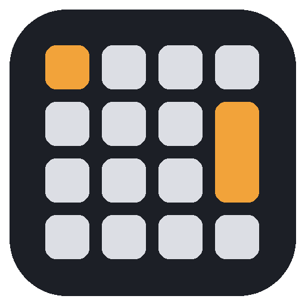

# Numpad Macros

**Convierte un numpad USB (o la fila de números de tu teclado) en una botonera de sonidos y atajos, sin tocar tu teclado principal.**

[](https://github.com/OkumaWsX/NumpadMacros/releases/latest)
[](https://github.com/OkumaWsX/NumpadMacros/actions/workflows/build.yml)
[](LICENSE)

[](https://discord.gg/hcutJcBx9)

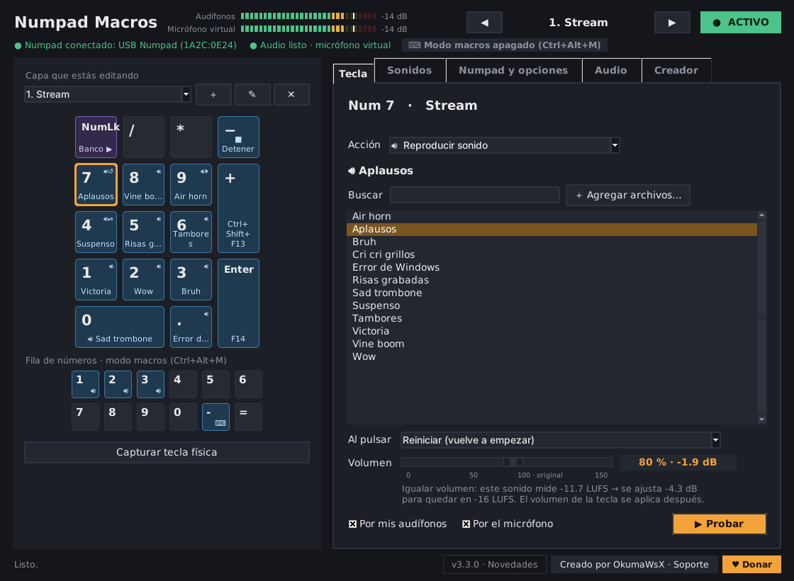

</div>

---

## ¿Qué es?

Numpad Macros es una aplicación de escritorio **gratuita y de código abierto** pensada para streamers, gamers y creadores de contenido. Cada tecla del numpad puede **reproducir un sonido** (que se escucha en tus audífonos y también por tu micrófono en Discord, OBS o el juego) o **enviar un atajo de teclado** a cualquier programa.

Es independiente: trae su propia biblioteca y su propio reproductor de sonidos, así que **no necesita Soundpad** ni otro programa.

## Novedades de la versión 3.4

<sub>Capturas de la versión 3.4.0. Las de cada versión están en sus [Releases](https://github.com/OkumaWsX/NumpadMacros/releases).</sub>

| Teclas virtuales y colores | Temas |
|---|---|
| 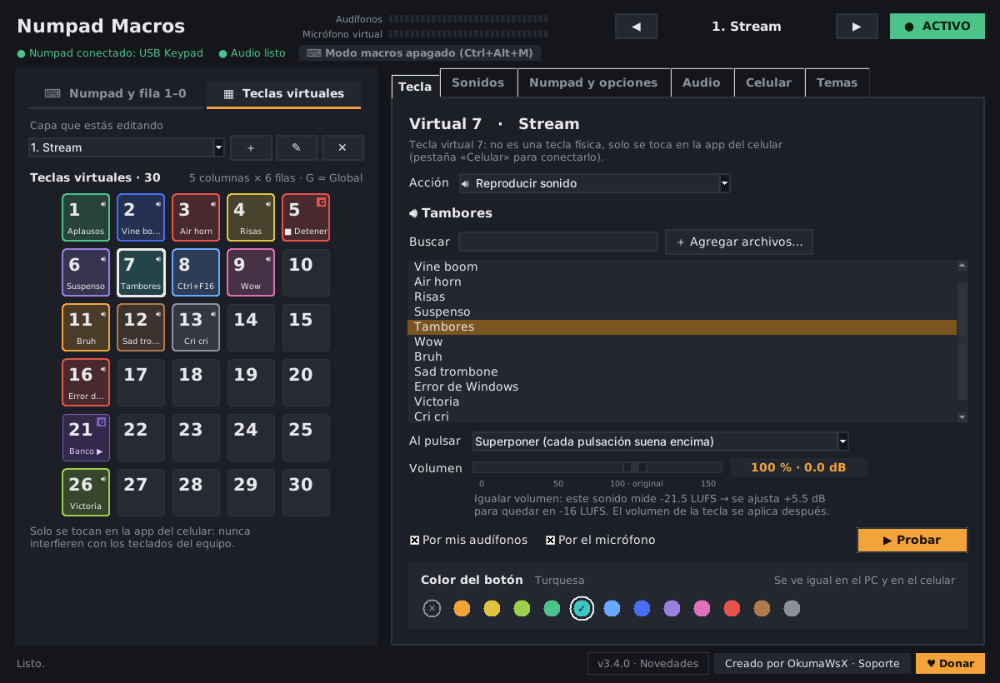 | 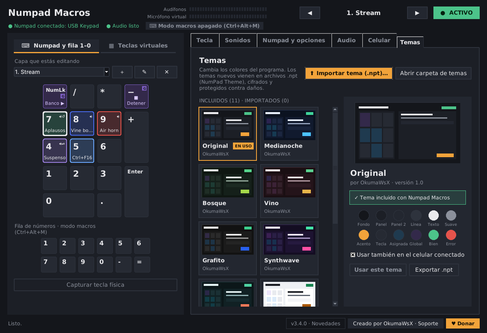 |
| **30 teclas virtuales** (5 × 6) que se tocan desde la app del celular y nunca chocan con tus teclados. Cada botón puede tener **su propio color**. | **11 temas** incluidos y nuevos temas en archivos **.npt** (cifrados y protegidos contra daños). |
| 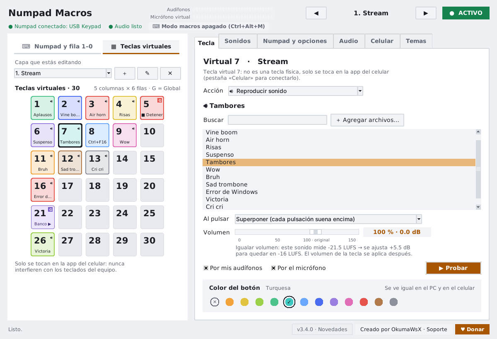 | 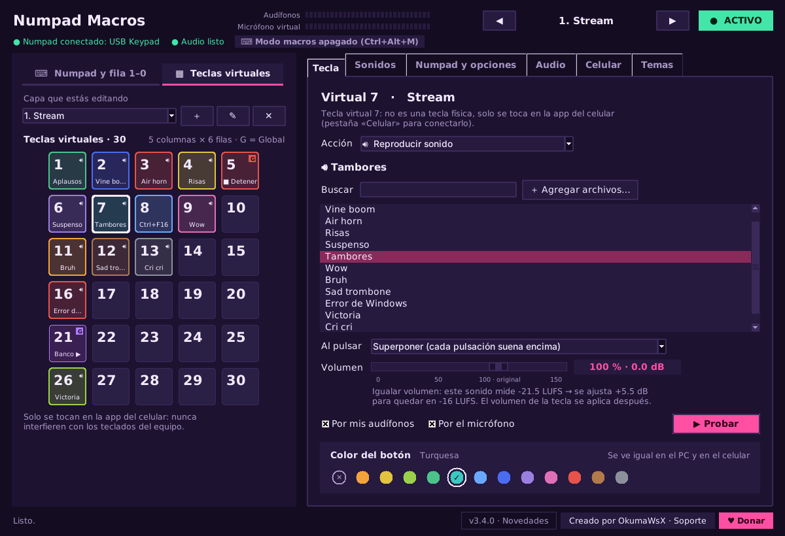 |

**App para Android:** lanza y edita tus sonidos desde el celular por Wi-Fi, cable USB o Bluetooth (pestaña **Celular**). Con el modo **Solo celular** el programa funciona sin ningún teclado.

🔍 Esta versión esconde algunas sorpresas. ¿Las encontrarás?

## Novedades de la versión 3.3

<sub>Capturas de la versión 3.3.0. Las de cada versión están en sus [Releases](https://github.com/OkumaWsX/NumpadMacros/releases).</sub>

| Medidores en tiempo real | Igualar volumen y compresor |
|---|---|
|  | 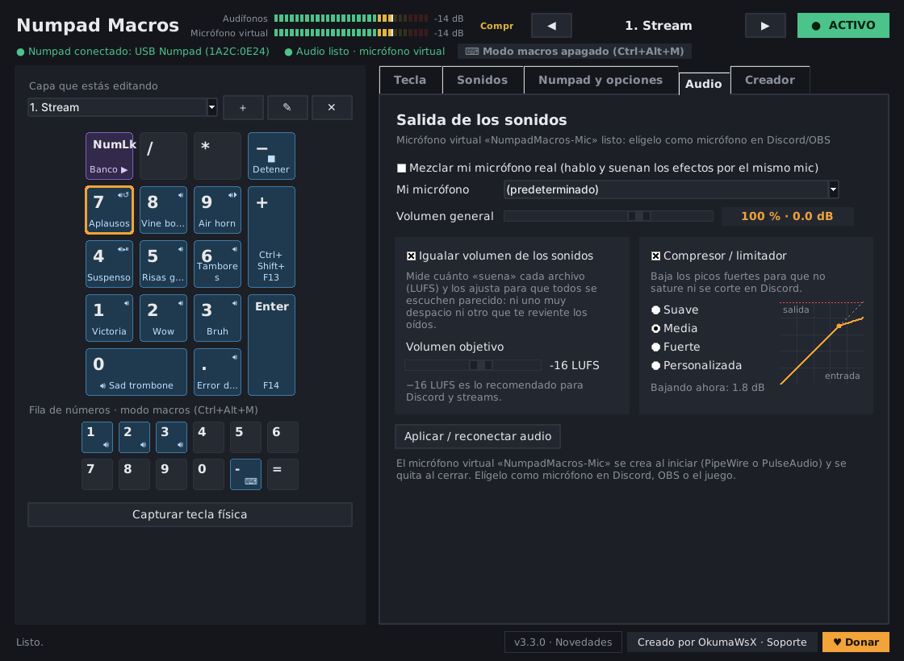 |
| Arriba se ve lo que suena en tus audífonos y en el micrófono virtual. El volumen de cada tecla se muestra en **% y dB** mientras lo mueves. | **Igualar volumen** deja todos los sonidos al mismo nivel (LUFS) y el **compresor/limitador** evita que saturen en Discord. |
| **Actualización con un clic** | **Novedades de tu versión** |
| 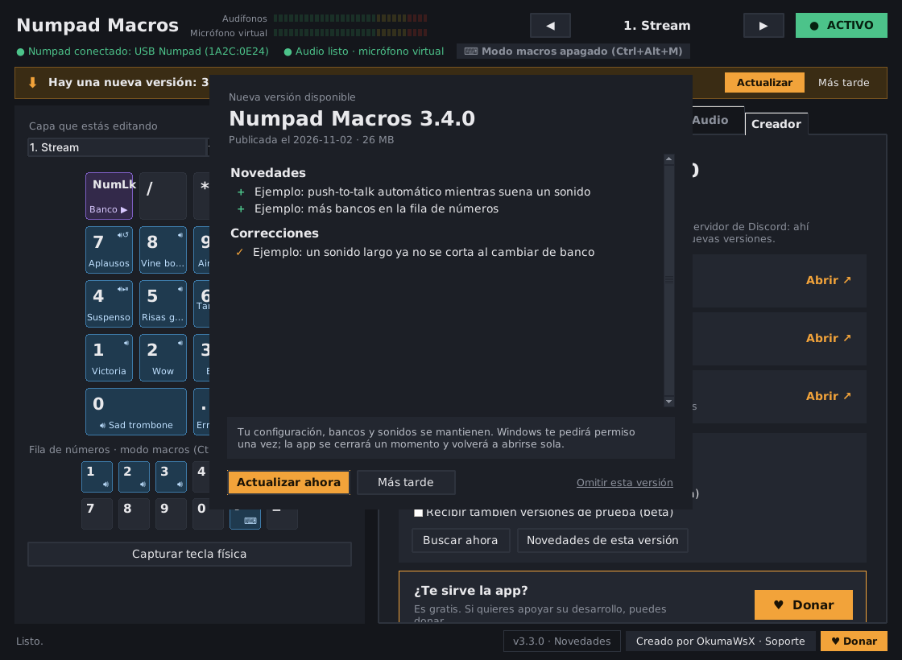 | 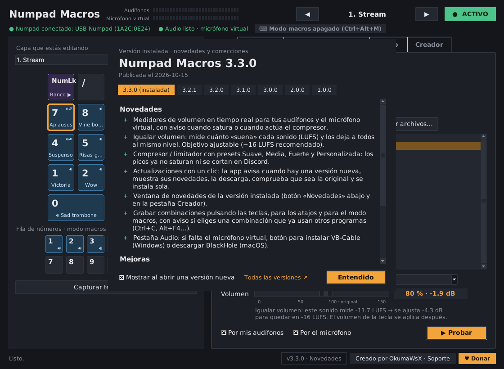 |
| Cuando sale una versión nueva aparece un aviso: **Actualizar ahora** la descarga, comprueba que sea la original y se instala sola. | El botón **Novedades** de abajo muestra qué trae la versión instalada y las anteriores. |

<p align="center">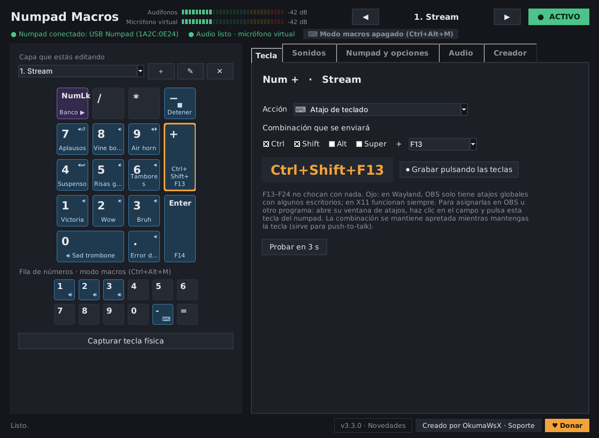<br><sub>Las combinaciones se pueden <b>grabar pulsando las teclas</b>, con aviso si chocan con otros programas.</sub></p>

## Características

| | |
|---|---|
| 🎹 **Solo tu numpad** | Detecta el numpad exacto y lo toma en exclusiva. Tu teclado principal sigue funcionando normal. |
| ⌨️ **Sin numpad también** | El **modo macros** (`Ctrl+Alt+M`) convierte la fila `1–0`, `-` y `=` de tu teclado en teclas macro. Las demás teclas siguen escribiendo. |
| 🔊 **Biblioteca de sonidos** | Agrega archivos o carpetas completas (MP3, WAV, OGG, FLAC, OPUS), búscalos, escúchalos y asígnalos con un clic. |
| 🎙️ **Micrófono virtual** | Los sonidos salen por tus audífonos y por un micrófono virtual. También puedes mezclar tu micrófono real para hablar y lanzar efectos a la vez. |
| ⏯️ **4 formas de sonar** | Superponer, Reiniciar, Alternar (pulsa para sonar y otra vez para detener) o *Mientras se mantiene*. Volumen por tecla. |
| 🧩 **Atajos de teclado** | Cualquier combinación (por ejemplo `Ctrl+Shift+F13`) para OBS, Discord u otro programa. Se mantiene apretada mientras mantienes la tecla (sirve para push-to-talk). |
| 📊 **Medidores y nivelación** | Medidores en tiempo real, **igualar volumen** (LUFS) para que todos los sonidos suenen parejo y **compresor/limitador** para que nada sature en Discord. |
| 🔄 **Se actualiza sola** | Avisa cuando hay una versión nueva y se actualiza con un clic, sin perder tu configuración. |
| 🗂️ **Bancos** | Varias páginas de asignaciones. La capa *Global* aplica en todos los bancos; `NumLock` cambia de banco. |
| 📥 **Importa desde Soundpad** | Trae tus sonidos desde una lista `.spl` de Soundpad. |
| 💻 **Multiplataforma** | Windows 10/11, Linux (X11 y Wayland) y macOS. |

## Descarga

### Windows 10/11 — descarga directa

<p align="center"><a href="https://github.com/OkumaWsX/NumpadMacros/releases/latest/download/NumpadMacros-Windows-Setup.exe"></a></p>

El botón descarga siempre **la última versión** (`NumpadMacros-Windows-Setup.exe`, unos 25 MB). Ábrelo y sigue el asistente *Siguiente → Siguiente → Instalar*.

> Como la app no tiene una firma digital pagada, la primera vez puede aparecer «Windows protegió su PC». Pulsa **Más información → Ejecutar de todas formas**.

### Todas las plataformas

En **[Releases](https://github.com/OkumaWsX/NumpadMacros/releases)** se publican todas las versiones:

| Sistema | Archivo | Cómo se instala |
|---|---|---|
| **Windows 10/11** | `NumpadMacros-Windows-Setup.exe` | Asistente *Siguiente → Siguiente → Instalar* |
| Windows (portátil) | `NumpadMacros-Windows-portable.zip` | Descomprimir y abrir `NumpadMacros.exe` |
| **Linux** | `NumpadMacros-Linux.tar.gz` | Descomprimir y ejecutar `./instalar_linux.sh` |
| **macOS** | `NumpadMacros-macOS.zip` | Mover a *Aplicaciones* y abrir con clic derecho → *Abrir* |

## Instalación

<details open>
<summary><b>Windows</b></summary>

1. Abre `NumpadMacros-Windows-Setup.exe` y sigue el asistente.
2. En el paso de componentes vienen marcados:
   - **Driver Interception**, para que la app use *solo* tu numpad (incluido en el instalador).
   - **VB-Cable**, el micrófono virtual. Se descarga de la página oficial de VB-Audio; en su ventana pulsa **Install Driver**.
3. Reinicia cuando el instalador lo pida.
4. En la pestaña **Audio** elige «CABLE Input» como micrófono virtual, y en Discord, OBS o el juego elige «CABLE Output» como micrófono.

<p align="center">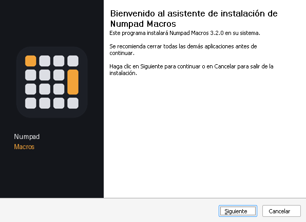 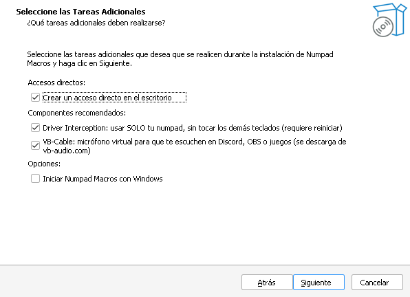</p>

Sin el driver Interception la app funciona igual en *modo sin driver* (captura el numpad de cualquier teclado).
</details>

<details>
<summary><b>Linux</b></summary>

1. Descomprime `NumpadMacros-Linux.tar.gz` y ejecuta `./instalar_linux.sh`. La app queda en el menú de aplicaciones.
2. La primera vez, en **Numpad y opciones**, pulsa **Dar permisos…** y escribe tu contraseña. Funciona al instante, sin cerrar sesión.
3. El micrófono virtual **NumpadMacros-Mic** se crea solo (PipeWire o PulseAudio). Elígelo como micrófono en Discord, OBS o el juego.
</details>

<details>
<summary><b>macOS</b></summary>

1. Descomprime `NumpadMacros-macOS.zip`, mueve **Numpad Macros** a *Aplicaciones* y ábrelo con **clic derecho → Abrir**.
2. En **Ajustes del Sistema → Privacidad y seguridad**, activa Numpad Macros en **Monitoreo de entrada** y en **Accesibilidad**.
3. Para el micrófono virtual instala **[BlackHole 2ch](https://existential.audio/blackhole/)** (gratis) y elígelo en la pestaña **Audio** y en Discord, OBS o el juego.
</details>

## Uso rápido

1. **Numpad y opciones → Detectar numpad**, y pulsa una tecla de tu numpad.
2. **Sonidos → ＋ Carpeta…** para cargar tus efectos.
3. Haz clic en una tecla del dibujo, elige un sonido y pulsa **Asignar**.
4. Elige cómo suena y pruébalo con **▶ Probar**.

¿Sin numpad? Asigna sonidos a la **fila de números** del dibujo y pulsa `Ctrl+Alt+M` para activar el modo macros.

La guía completa está en **[LEEME.md](LEEME.md)**.

<details>
<summary><b>Más capturas</b></summary>

| Biblioteca de sonidos (con volumen medido) | Numpad y opciones |
|---|---|
| 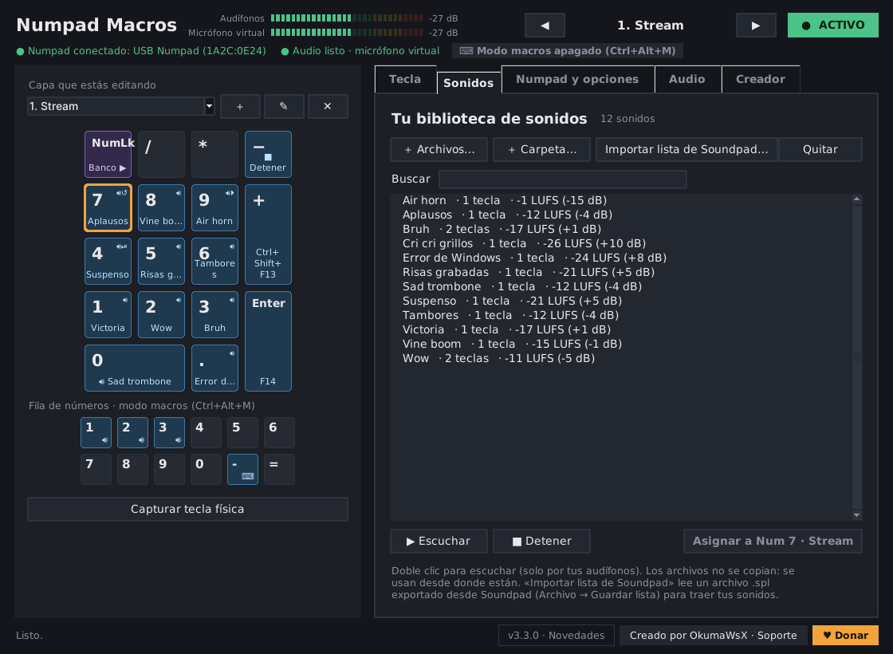 | 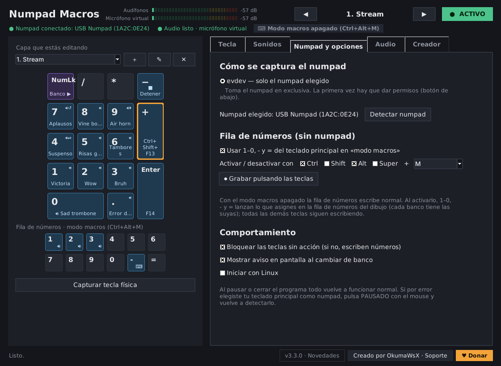 |
| **Audio** | **Creador y soporte** |
|  | 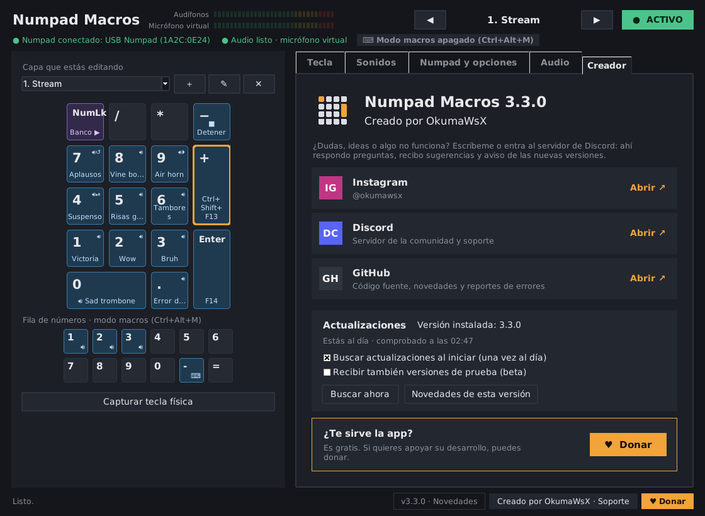 |
</details>

## Cómo funciona

| Sistema | Captura del numpad | Envío de atajos | Micrófono virtual |
|---|---|---|---|
| Windows | Driver [Interception](https://github.com/oblitum/Interception) (por dispositivo) o hook de teclado | `SendInput` | [VB-Cable](https://vb-audio.com/Cable/) |
| Linux | `evdev` con acceso exclusivo (`EVIOCGRAB`) | Teclado virtual `uinput` | Creado con PipeWire / PulseAudio |
| macOS | IOKit (`IOHIDManager`, modo *seize*) y `CGEventTap` | Eventos Quartz | [BlackHole](https://existential.audio/blackhole/) |

Más detalles para desarrolladores en **[docs/ARQUITECTURA.md](docs/ARQUITECTURA.md)**.

## Compilar desde el código

Requisitos: **Python 3.12** (con tkinter).

```bash
git clone https://github.com/OkumaWsX/NumpadMacros.git
cd NumpadMacros
python -m pip install -r requirements.txt
python NumpadMacros.pyw            # ejecutar sin compilar
python -m unittest discover -s tests   # pruebas
```

Para crear los programas:

| Sistema | Comando | Resultado |
|---|---|---|
| Windows | `crear_instalador.bat` (requiere [Inno Setup 6](https://jrsoftware.org/isinfo.php)) | `dist-installer\NumpadMacros-Setup-x.y.z.exe` |
| Linux / macOS | `./compilar.sh` | `dist/NumpadMacros` o `dist/Numpad Macros.app` |

**GitHub Actions** compila y prueba las tres versiones con cada cambio ([`build.yml`](.github/workflows/build.yml)). Para publicar una versión nueva se usa el robot **«Publicar versión»** ([`publicar.yml`](.github/workflows/publicar.yml)) o el programa **Publicador** ([`tools/publicador`](tools/publicador)); la guía está en **[docs/PUBLICAR.md](docs/PUBLICAR.md)**.

## Estructura del proyecto

```
NumpadMacros/
├── NumpadMacros.pyw        # punto de entrada
├── npm/                    # código de la app
│   ├── gui.py              # ventana (tkinter)
│   ├── engine.py           # lógica de teclas, bancos y modo macros
│   ├── capture_*.py        # captura del teclado por sistema
│   ├── send_*.py           # envío de atajos por sistema
│   ├── soundboard.py       # mezclador, reproductor y micrófono virtual
│   ├── loudness.py         # medición LUFS y compresor
│   ├── updater.py          # actualizaciones desde GitHub
│   ├── remote.py           # conexión con la app del celular (Wi-Fi, USB, Bluetooth)
│   ├── themes.py, npt.py   # temas y archivos de tema .npt
│   └── library.py          # biblioteca de sonidos
├── android/                # app para Android (Kotlin)
├── tests/                  # pruebas automáticas
├── installer/              # instalador de Windows (Inno Setup)
├── tools/                  # publicar versiones (release.py, el Publicador) y crear temas (crear_tema.py)
├── assets/                 # icono e imágenes
├── docs/                   # documentación y capturas
└── NumpadMacros.spec       # empaquetado con PyInstaller
```

## Contribuir

¡Los reportes de errores, ideas y pull requests son bienvenidos! Lee **[CONTRIBUTING.md](CONTRIBUTING.md)** antes de empezar. Para dudas rápidas, entra al **[servidor de Discord](https://discord.gg/hcutJcBx9)**.

## Apoya el proyecto

Numpad Macros es gratis. Si te sirve y quieres apoyar su desarrollo:

<p align="center"><a href="https://ceneka.net/OkumaWsX"></a></p>

## Licencia

Numpad Macros es software libre bajo la **[GNU Lesser General Public License v3.0](LICENSE)** (o posterior). La LGPL complementa a la [GNU GPL v3](COPYING), incluida también en el repositorio.

Componentes de terceros: ver **[THIRD_PARTY.md](THIRD_PARTY.md)**.

## Creador

Hecho por **OkumaWsX**

[](https://www.instagram.com/okumawsx)
[](https://discord.gg/hcutJcBx9)
